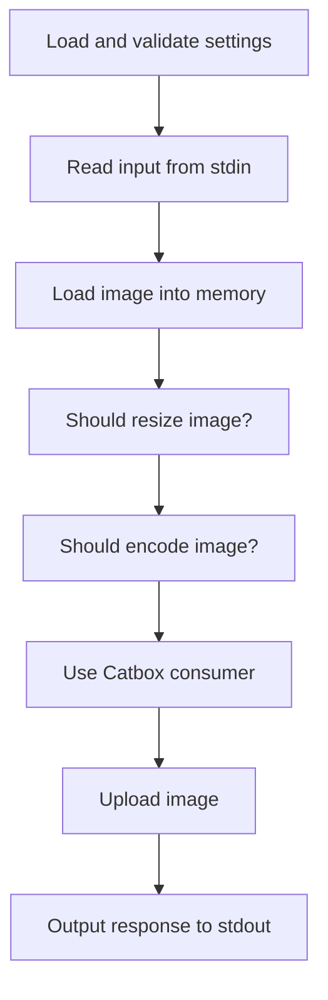

# foobar2000-catbox

*A helper application designed to upload album art to [catbox.moe](https://catbox.moe/) for use
with [foo_discord_rich](https://github.com/TheQwertiest/foo_discord_rich) or its forks.*

[](https://rust-lang.org/)

[](https://app.codecov.io/gh/realoksi/foobar2000-catbox)
[](https://github.com/realoksi/foobar2000-catbox/actions/workflows/rust.yml)
[](https://github.com/realoksi/foobar2000-catbox/releases/latest)


---

## Install

Download the [latest release](https://github.com/realoksi/foobar2000-catbox/releases), or
[compile it from source](#compile). Then follow the setup instructions
[here](https://theqwertiest.github.io/foo_discord_rich/docs/features/advanced_users/art_upload/).

See the [configuration](#configure) section for optional settings.

## Compile

Get [rustup](https://www.rust-lang.org/tools/install) and [git](https://git-scm.com/downloads).

Open a terminal.

Clone the repository
or [directly download](https://github.com/realoksi/foobar2000-catbox/archive/refs/heads/production.zip) and unzip it.

```sh
git clone https://github.com/realoksi/foobar2000-catbox.git
```

`cd` into the directory.

```sh
cd foobar2000-catbox
```

### Windows

Compile the application using the release profile.

```sh
cargo build -r
```

Find the executable at `target/release/foobar2000-catbox.exe`

### Cross-compiling from Linux

Add a Windows target with rustup.

```sh
rustup target add x86_64-pc-windows-gnu
```

You will also need [mingw-w64](https://www.mingw-w64.org/). See their **Getting Started** section for your distribution.

Compile a release build with the Windows target specified.

```sh
cargo build --target x86_64-pc-windows-gnu -r
```

Find the executable at `target/x86_64-pc-windows-gnu/release/foobar2000-catbox.exe`

> [!WARNING]
> The WEBP encoder used at this time is **lossless only**. Using this **will** increase the file size of the uploaded image - slowing down both the upload and download speed of your cover art.

You can get started by copying the full sample `settings.yml` included in this repository to the same directory as your configured `foobar2000-catbox.exe` application. Descriptions are available in the sample file, along with acceptable values.

## Troubleshooting

...

## Diagram

Here's a small flowchart; A non-precise visualization outlining the flow of the application.



## Notes

- Litterbox is now disabled by default, but remains available.

## TODO

- [ ] Add resize filter-type setting option
- [ ] Also use environment variables as configuration options
- [x] Write a mermaid chart outlining the process flow
- [x] Create basic compiling, installation, and usage instructions
- [x] More comprehensive testing
- [ ] Github actions for version releases
- [x] Reduce release version file size and compile time
- [ ] Write a troubleshooting section
- [ ] Aggressive encoding/downscaling to reach specific file size
- [ ] Automatic encoding from non-supported format to supported format (supported by Discord)
